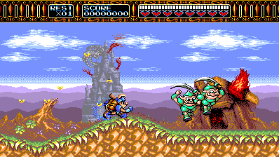
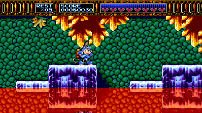
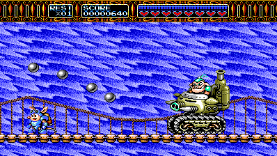
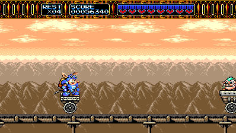

**Special thanks to l0ll0_76 (L0LL0) for extensive QA and playtesting of Rocket Knight Adventures Recomp.**

# Rocket Knight Adventures Recomp

An unofficial native PC port of **Rocket Knight Adventures** (Konami, 1993)
for the Sega Genesis / Mega Drive, built with the
[Genesis recompilation framework](https://github.com/mstan/segagenesisrecomp).
Play with adaptive widescreen, remappable controls, rewind, and a visual
save-state browser.

Version 1.0 is the first stable release: adaptive widescreen covers all seven
stages and is on by default.

**[Download v1.0.1](https://github.com/mstan/RocketKnightAdventuresRecomp/releases/tag/v1.0.1)**
· [Release notes](release/v1.0.1.md)
· [Report a bug](https://github.com/mstan/RocketKnightAdventuresRecomp/issues)

You must supply your own **Rocket Knight Adventures (USA)** ROM. The source
and release packages do not include the game ROM.

## Adaptive widescreen in action

| Forest | Crystal caves |
| :---: | :---: |
|  |  |
| **Bridge boss** | **Minecart ride** |
|  |  |

Captured from v0.1.13 with **Adaptive (fit window)** at 16:9 and **Expanded
Spawn Range**. Adaptive follows the window when you resize it; the game
pixels keep their proportions.

## Features

- **Adaptive widescreen:** additional scenery and actors across all seven
  stages, including vehicle sections, boss arenas, and cutscenes. Fixed
  16:9, 21:9, and 32:9 modes are also available.
- **Rewind:** browse snapshots of recent play and return to an earlier moment.
- **Visual save states:** nine slots with previews, plus direct slot shortcuts.
- **Keyboard and controllers:** simultaneous input and remappable bindings.
- **Built-in mods:** choose enemy activation timing and optionally enable
  Start Stage, Infinite Lives, Infinite Health, or Invincible.

## Get started

| Platform | Download | Requirements |
| --- | --- | --- |
| Windows x64 | [ZIP](https://github.com/mstan/RocketKnightAdventuresRecomp/releases/download/v1.0.0/RocketKnightAdventuresRecomp-windows-x64-v1.0.0.zip) | 64-bit Windows with working OpenGL |
| Linux x86_64 | [AppImage](https://github.com/mstan/RocketKnightAdventuresRecomp/releases/download/v1.0.0/RocketKnightAdventuresRecomp-linux-x86_64-v1.0.0.AppImage) | Ubuntu 24.04 or a compatible system; glibc 2.39 and working OpenGL |

[SHA-256 checksums](https://github.com/mstan/RocketKnightAdventuresRecomp/releases/download/v1.0.0/SHA256SUMS.txt)
are available for both packages. Older Linux distributions and Steam Deck
have not been validated.

1. Extract the entire Windows ZIP into a writable folder, or place the Linux
   AppImage in one and make it executable with `chmod +x`.
2. Run `RKARecomp.exe` or the AppImage and select your ROM in the launcher.
3. Launch the game. Widescreen starts on in **Adaptive (fit window)**; resize
   the window to change the visible playfield.
4. For the original 4:3 view or a fixed aspect ratio, open **Mods >
   Widescreen** in the launcher and turn it off or choose another mode.

The supported ROM is a raw **USA** cartridge dump: **1,048,576 bytes**, CRC32
**`A6EFEC47`**. Other regions and modified ROMs are unsupported.

On Linux, use `--appimage-extract-and-run` if FUSE is unavailable. The ROM
picker uses `zenity`, `kdialog`, or `yad`; you can also place the ROM beside
the AppImage as `rka.bin`, or pass its path on the command line.

Settings and save states live beside the executable or AppImage. When
upgrading, preserve `settings.ini`, `rka-video.ini`, `rom-RKA.cfg`, and your
`native_save_N.bin` files. A saved Widescreen choice is kept: if an earlier
version saved it as off, turn it on under **Mods > Widescreen**.

## Widescreen and enemy activation

Widescreen is on by default in **Adaptive (fit window)**, which fits the
current window; fixed 16:9, 21:9, and 32:9 modes are also available. The
original playfield remains the minimum width, and the HUD counters stay
centered. Some title, menu, and presentation screens retain the original
centered picture. Turning the Widescreen mod off restores the original view
and activation rules.

**Mods > Widescreen > Enemy activation** offers two choices:

- **Expanded Spawn Range** (default) brings enemies into the wider view
  earlier and keeps them active longer. This changes encounter timing and
  can put more enemies on screen. The castle fire corridor retains its
  original placement timing to avoid activating its linked effects early.
- **Original Spawn Range** keeps the original camera's activation timing.
  Enemies can visibly appear inside the wider view when they enter that range.

For a direct launch, pass the ROM and optionally a mode (`fit`, `16:9`,
`21:9`, `32:9`, or `off` for the original view):

```text
RKARecomp.exe rka.bin --no-launcher --widescreen fit
```

## Controls, saves, and rewind

Default game controls can be remapped in the launcher.

| Action | Keyboard | Xbox / PlayStation controller |
| --- | --- | --- |
| Move | Arrow keys | D-pad or left stick |
| Jump (Genesis B) | X | A / Cross |
| Attack / charge rocket (Genesis A or C) | Z or C | B / Circle or X / Square |
| Start / pause | Enter | Start / Options |

| Tool | Keyboard | Controller |
| --- | --- | --- |
| Save-state browser | F7 | Back/View + RB |
| Rewind browser | F8 | Back/View + right-stick click |

In either browser, use arrows or the D-pad to select, **Enter / A** to load
or restore, and **Esc / B** to cancel. In the save-state browser, **S / X**
saves into the selected slot. Browser button names refer to the Xbox layout.

Rewind needs a few seconds of play to build its history. Its depth and
snapshot interval are configurable in the launcher. Existing
`native_save_N.bin` files work in the visual browser.

<details>
<summary>Direct save-slot shortcuts</summary>

**Shift+F1–F9** saves to a slot. **F1–F6** and **F9** load directly;
**Ctrl+F7** and **Ctrl+F8** load slots 7 and 8.

</details>

## Known issues

Version 1.0 is the first stable release. It has been exercised across all
54 stage areas, all 41 authored intro, stage, and ending area IDs in long
assisted 32:9 routes, and tester-provided saves from all seven stages, with
automated renderer and Windows/Linux package checks. Some visual
imperfections remain:

- A few arena and cutscene margins repeat or mirror background details,
  particularly in the later machine room and the Earth transition. Some boss
  artwork clips at arena edges.
- A flying boss can briefly show a thin propeller slice at the extreme screen
  edge as it enters the view.
- The attract demo can diverge from its recorded inputs, so Sparkster may
  die during the demonstration.

## Reporting bugs

[Open an issue](https://github.com/mstan/RocketKnightAdventuresRecomp/issues)
with the release version, operating system, stage, aspect ratio, enemy
activation setting, and steps to reproduce. A screenshot or short recording
helps with visual problems; a `native_save_N.bin` from just before the problem
is especially useful.

If generated, attach `dispatch_misses.toml`, `interior_label_misses.toml`,
`floor_unsafe.toml`, and `floor_coverage.toml` from the game folder. Please
do not attach your ROM.

## Building from source

Clone with submodules, then place the supported ROM at `game/rka.bin`:

```sh
git clone --recurse-submodules https://github.com/mstan/RocketKnightAdventuresRecomp.git
cd RocketKnightAdventuresRecomp
```

**Windows:** install Visual Studio 2022 with C++ build tools, CMake, and Python 3.

```powershell
cmake -S . -B build -G "Visual Studio 17 2022" -A x64
cmake --build build --config Release --target RKARecomp --parallel
./build/Release/RKARecomp.exe
```

**Linux:** install a C/C++ compiler, CMake, Python 3, `pkg-config`, SDL2
development headers, and OpenGL development libraries.

```sh
cmake -S . -B build -DCMAKE_BUILD_TYPE=Release
cmake --build build --target RKARecomp --parallel
./build/RKARecomp
```

CMake builds the recompiler and generates the game code from your ROM.
See [RELEASING.md](RELEASING.md) for production builds and packaging.

## How it works

The project recompiles the game's 68000 code to C and uses the shared
[segagenesisrecomp](https://github.com/mstan/segagenesisrecomp) runtime for
graphics, audio, and execution. Code not yet covered by static recompilation
runs through the runtime's 68000 interpreter fallback; coverage reports help
bring more of those routines into the generated code.

RKA's custom renderer reconstructs the wider scenery from the game's level
layouts and live graphics data. The game-specific implementation and address
notes are in [game/CUSTOM-VIDEO.md](game/CUSTOM-VIDEO.md). The launcher comes
from [recomp-ui](https://github.com/mstan/recomp-ui), and the shared
[rbengine](https://github.com/RetroPortingToolKit/rbengine) snapshot system supports rewind.

## License and acknowledgments

The port and framework use the
[PolyForm Noncommercial 1.0.0 license](LICENSE.md). Third-party components
retain their own licenses; release packages include `THIRD-PARTY-LICENSES.md`
and a `licenses/` directory.

Thanks to the shared framework contributors and the testers who supplied
playthrough feedback, screenshots, and save states. Rocket Knight Adventures
and its game artwork belong to Konami. This project is unofficial and is not
affiliated with Konami or Sega.
